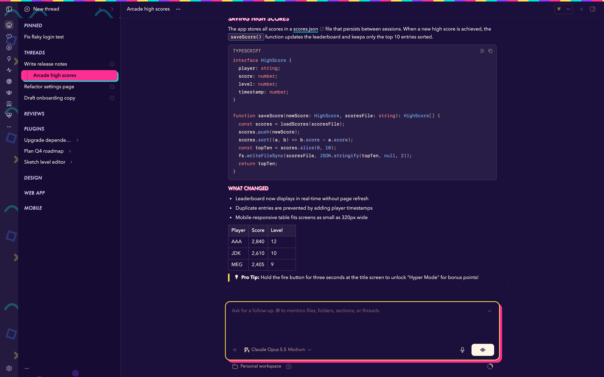
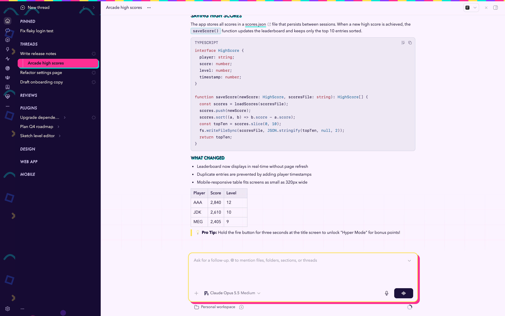

# Rad Binder

An 80s/90s school-binder and toy-commercial theme for [bb](https://getbb.app): a deep-purple binder-spine sidebar with neon confetti, striped binder edges, chunky offset shadows and bold italic display headings. Light and dark.





## Install

From the bb Community marketplace, or:

```sh
bb plugin install git:https://github.com/steveafrost/bb-theme-rad-binder.git
bb theme set plugin:rad-binder:rad-binder
```

## Notes

- Fonts: Futura and Avenir Next (bundled with macOS); falls back to the system sans elsewhere.
- Diffs and file previews: Synthwave '84 (dark) and Catppuccin Latte (light).
- No network requests. Original patterns and colours; no brand marks.

## License

MIT
